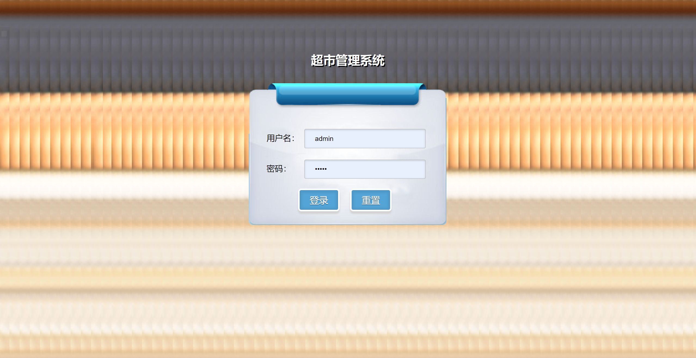
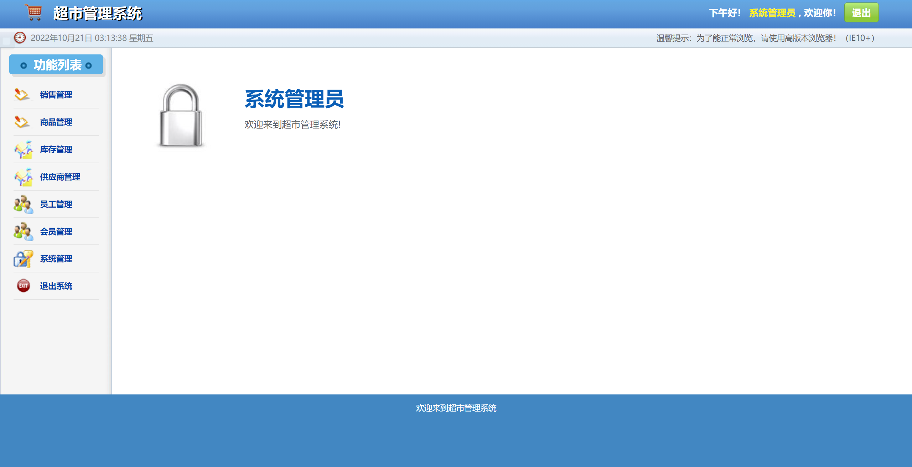
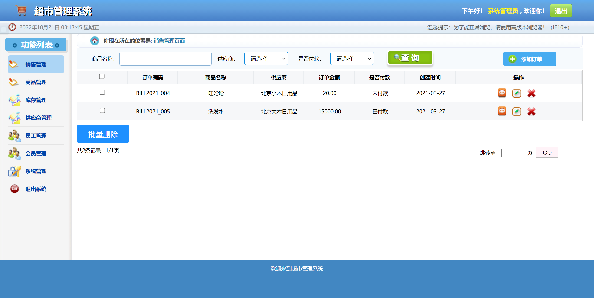
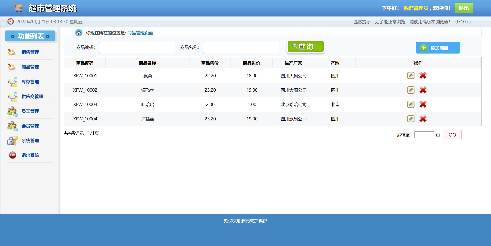
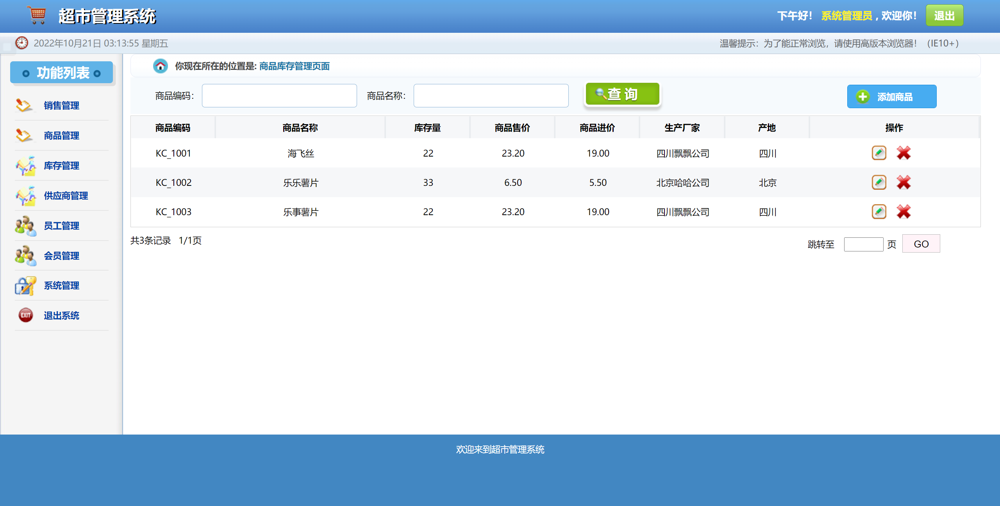
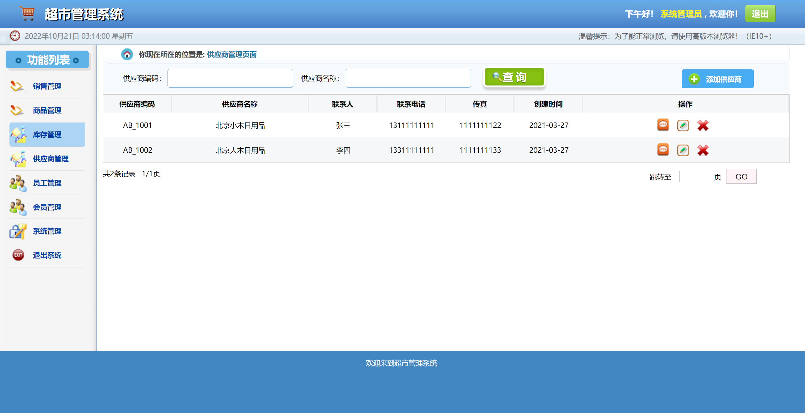
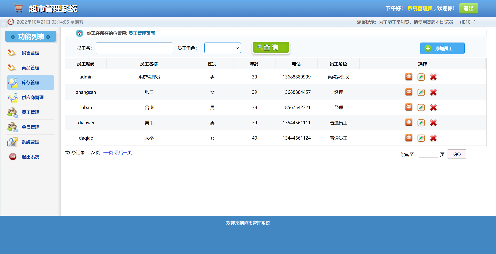
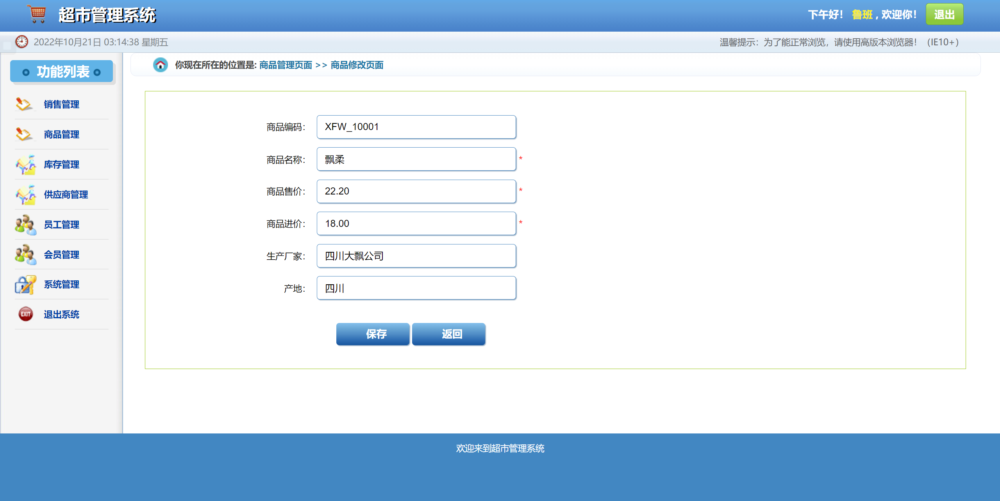
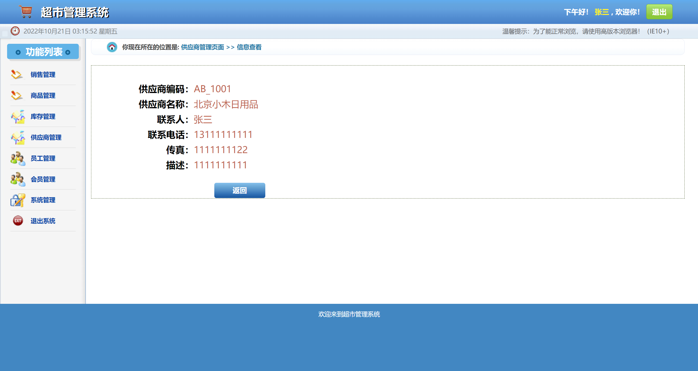

# -- 全局占位符：将 {SITE_URL} 替换为正式站点地址 -->（SSM）— 完整源码 + 数据库脚本 + 运行说明
# 超市管理系统_ssm+jsp
**关键词**：-- 全局占位符：将 {SITE_URL} 替换为正式站点地址 -->、Java、Java、管理系统、源码、数据库脚本、课程设计、毕业设计、毕设、项目实战、学习参考

本商品为「超市管理系统_ssm+jsp」，基于 SSM 技术栈开发。

## 👉 完整项目 / 演示录屏 / 更多项目：{SITE_URL}

## ✨ 功能清单

- bill
- 会员
- 商品
- provider
- role
- 库存
- 用户
- err
- bill添加
- bill列表
- bill修改
- bill查看
- frame
- 会员添加
- 会员列表
- 会员修改
- 商品添加
- 商品列表
- 商品修改
- provider添加

## 🛠 技术栈

- junit: 3.8.1
- spring-web: 3.2.13.RELEASE
- spring-webmvc: 3.2.13.RELEASE
- log4j: 1.2.17
- mybatis: 3.2.2
- mysql-connector-java: 8.0.13
- aspectjweaver: 1.6.9
- commons-dbcp: 1.4
- mybatis-spring: 1.2.0
- spring-jdbc: 3.2.13.RELEASE
- spring-tx: 3.2.13.RELEASE
- servlet-api: 2.5
- jsp-api: 2.2
- jstl: 1.2
- pager-taglib: 2.0

## 📁 目录结构

```
chao-shi-guan-li-xi-tong-ssm-jsp-ssm/
├── .settings/
│   ├── .jsdtscope
│   ├── org.eclipse.jdt.core.prefs
│   ├── org.eclipse.m2e.core.prefs
│   ├── org.eclipse.wst.common.component
│   ├── org.eclipse.wst.common.project.facet.core.xml
│   ├── org.eclipse.wst.common.project.facet.core.xml.bak
│   ├── org.eclipse.wst.jsdt.ui.superType.container
│   ├── org.eclipse.wst.jsdt.ui.superType.name
│   └── org.eclipse.wst.validation.prefs
├── db/
│   └── smbms.sql
├── docs/
│   ├── DESENSITIZE.md
│   └── REVIEW.md
├── src/
│   ├── main/
│   └── test/
├── 运行截图/
│   ├── Snipaste_2022-10-21_03-13-01.png
│   ├── Snipaste_2022-10-21_03-13-41.png
│   ├── Snipaste_2022-10-21_03-13-48.png
│   ├── Snipaste_2022-10-21_03-13-53.png
│   ├── Snipaste_2022-10-21_03-13-58.png
│   ├── Snipaste_2022-10-21_03-14-03.png
│   ├── Snipaste_2022-10-21_03-14-07.png
│   ├── Snipaste_2022-10-21_03-14-41.png
│   └── Snipaste_2022-10-21_03-15-55.png
├── .classpath
├── .project
├── pom.xml
└── 运行必读.txt
```

## 🚀 快速开始

### 环境要求
- JDK 1.8+（以 `pom.xml` 为准）
- Maven 3.x
- MySQL 5.7+ / 8.x

### 步骤
1. 克隆本仓库
2. 用 IDE 打开项目根目录（含 `pom.xml` / `package.json`）
3. 导入 `db/` 或根目录下的 `*.sql` 到 MySQL
4. 修改 `src/main/resources/application.yml`（或 `.properties`）中的数据库账号密码
5. 启动主启动类（`*Application.java`）或执行 `mvn spring-boot:run`
6. 浏览器访问 `http://localhost:8080`

### 端口
- `8080`

### 账号
- 系统账号信息
- 账号：admin
- 密码：12345678

## 📸 截图











## ❓ 常见问题

**跑不起来？**
- 确认 JDK / Maven / MySQL 版本与运行必读一致；先能编译通过再启动。

**端口占用？**
- 修改 `server.port`，或关闭占用 8080 的进程。

**数据库连接失败？**
- 检查库名是否已创建、账号密码、时区与 `allowPublicKeyRetrieval` 等 JDBC 参数。

## 📚 更多开源项目

完整清单见仓库内 [`PROJECTS.md`](./PROJECTS.md)。

## 免责声明与许可

- 本仓库仅供学习交流，不包含商业授权。
- 源码来源于教学/毕设实践整理，使用风险自负。
- 转载请注明出处；请勿用于非法用途。
- 详见 [`LICENSE`](./LICENSE)。

---

**更多完整项目 → {SITE_URL}**